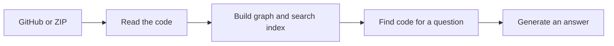
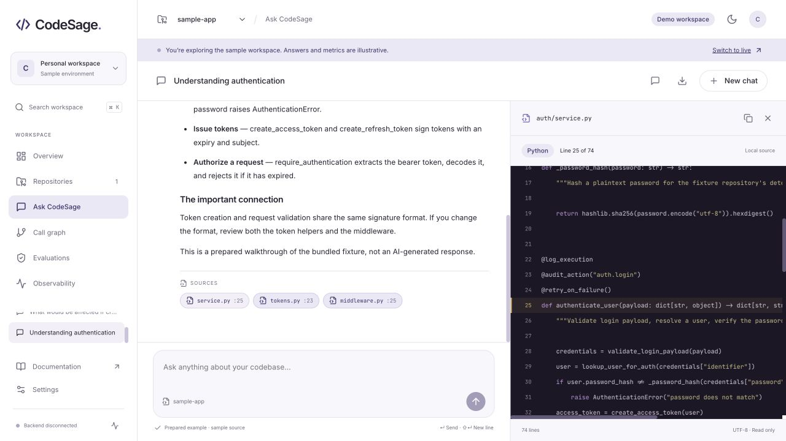

# CodeSage

CodeSage helps you understand a codebase. Import code, ask questions, and see how functions connect.

Built by [Yash Jain](https://github.com/YashJain2410) with Next.js, FastAPI, and Qdrant.



## What works

- Public GitHub import and ZIP upload use the same indexing flow.
- The graph shows functions, classes, and their connections.
- Chat uses code search and related functions to build an answer.
- Demo mode runs without a backend. Its answers and scores are examples.

The backend keeps one active repository. Live answers currently return no citations and a fixed confidence score. See [current limitations](docs/API.md#current-limitations).



## Try the demo

Use Node.js 20.9 or later. From the repository root:

```bash
cd frontend-next
npm ci
cp .env.example .env.local
npm run dev
```

Open [localhost:3000](http://localhost:3000) and choose **Explore the demo**.

For real repositories, follow [Getting started](docs/GETTING-STARTED.md).

## Project folders

| Folder | Contents |
| --- | --- |
| `frontend-next/` | Current web app |
| `backend/` | API, code search, indexing, and tests |
| `infra/` | Local services and monitoring |
| `docs/` | Setup and technical guides |
| `frontend/` | Earlier frontend |
| `notebooks/` | Experiments |

## Read next

[Setup](docs/GETTING-STARTED.md) · [Architecture](docs/ARCHITECTURE.md) · [GitHub import](docs/GITHUB-IMPORT.md) · [All guides](docs/README.md)

This is a personal portfolio project and is not accepting contributions. Public deployment and support for multiple users are unfinished. There is no project license; bundled fonts have their own licenses.
