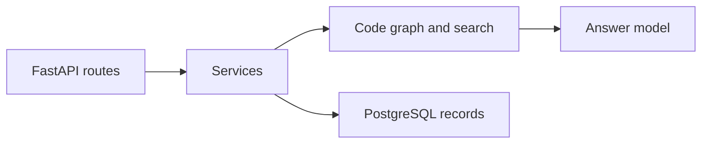

# CodeSage backend

The Python API imports code, builds a graph and search index, and answers questions.

## Run it

Follow [Getting started](../docs/GETTING-STARTED.md). Use Python 3.12 and install `requirements.txt`. Settings read the repository-root `.env`.

## Find the code

| Folder | Purpose |
| --- | --- |
| `app/api/` | HTTP routes |
| `app/services/` | Import, indexing, and query steps |
| `app/core/` | Parsers, graph, search, and answer workflow |
| `app/db/` | Repository records and migrations |
| `app/evaluation/` | Answer-quality checks |
| `app/observability/` | Logs and metrics |
| `app/workers/` | Worker code; current imports wait for indexing |
| `tests/` | Tests and sample repository |

`pyproject.toml` lists only part of the dependencies. `requirements1.txt` and `requirements2.txt` are older lists.

[API routes](../docs/API.md) · [Architecture](../docs/ARCHITECTURE.md) · [Tests](../docs/TESTING.md)
