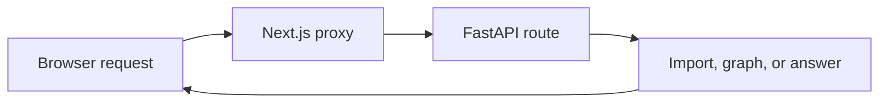

# API reference

Local API: `http://127.0.0.1:8000`. See the running [API docs](http://localhost:8000/docs) or [route list](http://localhost:8000/openapi.json).



## Current routes

| Method | Route | Input | Result |
| --- | --- | --- | --- |
| GET | `/` | None | App message; does not check other services |
| POST | `/repositories/upload` | ZIP file in form field `file` | Repository ID, `READY`, node and edge counts |
| POST | `/repositories/github` | Public URL in form field `github_url` | Same result as ZIP upload |
| POST | `/query` | JSON below | Answer, intent, confidence, citations |
| GET | `/graph` | None | Current graph; 404 if none is loaded |
| GET | `/metrics` | None | Metrics in Prometheus text format |
| GET | `/openapi.json` | None | Registered routes and request fields |

Imports finish indexing before returning. GitHub URLs must use HTTPS and point to a public repository. `.git` and a trailing slash are accepted. [Import details](GITHUB-IMPORT.md).

## Ask a question

```json
{
  "query": "How does authentication work?",
  "repository_id": "id-from-import",
  "model_provider": "gemini",
  "model_name": "model-supported-by-your-account"
}
```

Both model fields are optional. Omit them to use the backend environment defaults. A provider override uses that provider’s configured model unless `model_name` is supplied. [Provider settings](MODEL-PROVIDERS.md).

Classification and answers use the same selected provider and model. Requests fail with a clear error instead of switching providers or guessing an intent after a model error.

Example response shape:

```json
{
  "answer": "Generated explanation",
  "intent": "EXPLAIN",
  "confidence": 1.0,
  "citations": [],
  "model_provider": "gemini",
  "model_name": "gemini-3.8-flash"
}
```

Confidence and citations currently use the fixed values shown above. The API requires `repository_id`, but always searches the active repository.

## Graph fields

- Nodes: `id`, `label`, `filepath`, `node_type`, `is_test`, `start_line`, `end_line`.
- Edges: `source`, `target`, `edge_type`, `resolved`.

An edge is a code connection found by the parser. It is not a measure of call frequency or test coverage.

## Error codes

| Code | Meaning |
| --- | --- |
| 400 | Invalid import input or missing/unsupported model configuration |
| 404 | No graph, missing route, or missing/private GitHub repository |
| 422 | Missing or invalid request fields |
| 500 | Indexing, database, or another server error |
| 502 | GitHub clone failed, or the selected model failed/returned no usable text |
| 503 | Git is not installed on the backend |
| 504 | GitHub clone exceeded two minutes |

## Current limitations

- The API has no login or separation between users.
- Only the latest indexed repository is active. API restarts lose its graph.
- Local-path import and `POST /index` have been removed.
- File/text import, evaluation, and health routes are not registered.
- Answer streaming, import progress, and source-file retrieval are not registered.
- TypeScript files use the JavaScript parser. Some declared settings are not used by the current components.

The frontend uses `current` mode for these routes. Future formats are in the [frontend API contract](../frontend-next/API-CONTRACT.md). See [Testing](TESTING.md) for known evaluation issues.
