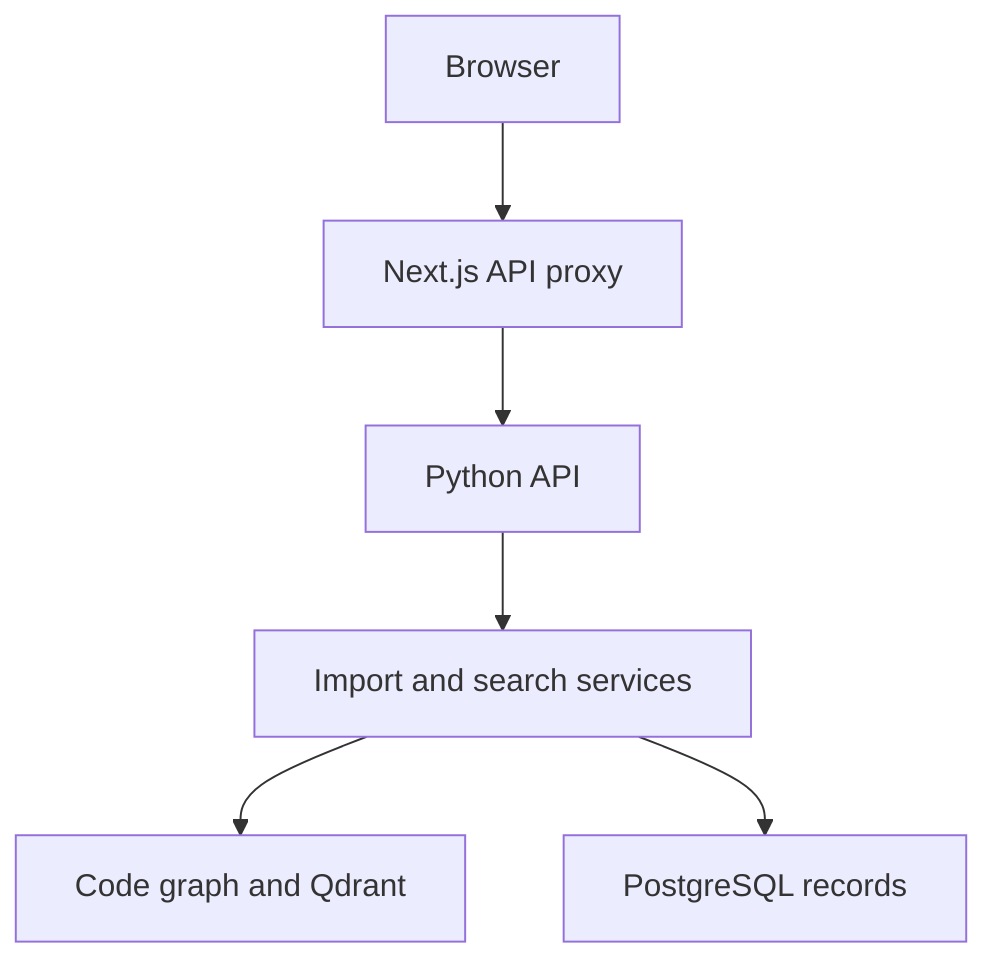
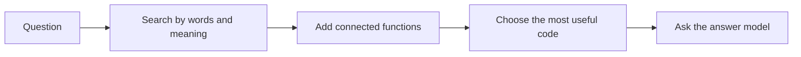

# Architecture

CodeSage has a Next.js frontend and a Python API. The API turns code into a graph and search index, then uses them to answer questions.

## Import code

GitHub import and ZIP upload use the same indexing service:

1. Read `.py`, `.js`, `.ts`, and `.tsx` files.
2. Find functions, classes, imports, and calls.
3. Build a graph of code connections.
4. Turn code into number lists called embeddings. Store them in Qdrant for similarity search.
5. Build a keyword index and save repository details in PostgreSQL.

See [GitHub import](GITHUB-IMPORT.md) for the code walkthrough.

## Answer a question

The question type, such as bug or test, helps choose related code. Keyword search finds exact names; vector search finds similar meaning. The results are combined before related functions are added and ranked.

Gemini or OpenAI writes the answer. The intent fallback still uses Gemini. Confidence is currently fixed at `1.0`, and citations are empty, so they do not measure answer quality yet.

## Where data lives

| Data | Location | What to know |
| --- | --- | --- |
| Active graph and keyword index | API memory | Lost when the API restarts |
| Code vectors | Qdrant | A successful new index replaces the previous collection |
| Repository details | PostgreSQL | These records cannot restore the graph by themselves |
| Imported source | Backend workspace folders | Kept on disk until cleaned up |
| Chats and repository history | Browser storage | Saved only in that browser |
| Uploaded source previews | Browser memory | Cleared on refresh |

## Current limits

- One repository is active at a time. `repository_id` does not select a separate graph.
- Multiple API workers do not share the active graph.
- Imports wait for indexing; the current routes do not use background jobs.
- TypeScript files currently use the JavaScript parser. TypeScript syntax needs more testing.
- The graph shows possible code connections. It does not prove which code ran in a test.

## Design tradeoffs

| Choice | Why use it? | Limit |
| --- | --- | --- |
| Parse functions and classes | Keep useful code boundaries | Some dynamic calls cannot be found |
| Keyword and vector search | Support names and plain-language questions | Both indexes need the same code version |
| Graph search and ranking | Add related code and choose useful matches | Adds work and model cost |
| Separate demo mode | Let anyone explore the UI | Sample answers do not prove real accuracy |

See [API limits](API.md#current-limitations) and [test results](TESTING.md).
