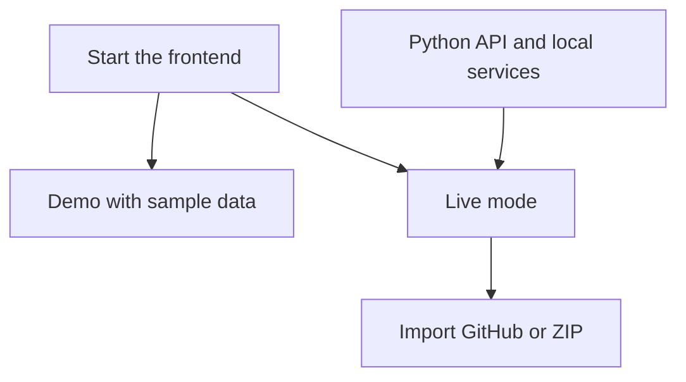

# Getting started

Use the demo to explore the interface. Start the backend when you want to import your own code.



## 1. Start the frontend

Use Node.js 20.9 or later. Run from the repository root:

```bash
cd frontend-next
npm ci
cp .env.example .env.local
npm run dev
```

Open [localhost:3000](http://localhost:3000). **Explore the demo** needs no backend or API key.

## 2. Set up the backend

You need Python 3.12, Git, Docker Compose, and a Gemini API key. Models download on first use.

In another terminal, run from the repository root:

```bash
python3.12 -m venv .venv
source .venv/bin/activate
python -m pip install -r backend/requirements.txt
cp .env.example .env
```

Edit the root `.env`:

- Set `GEMINI_API_KEY`.
- Keep the example `DATABASE_URL` when using the supplied Docker database.
- Delete the blank `REPO_PATH=` line to use the default folder.
- Add `OPENAI_API_KEY` only if you want OpenAI answers.

If `.env` already exists, edit it instead of copying over it. Keep keys out of Git.

## 3. Start the API and services

From the repository root, with the Python environment active:

```bash
docker compose -f infra/docker-compose.yml up -d postgres redis qdrant
cd backend
python -m alembic -c ../alembic.ini upgrade head
python -m uvicorn app.main:app --reload --host 127.0.0.1 --port 8000
```

Open the [API docs](http://localhost:8000/docs) to check the routes.

## 4. Import your code

In the frontend, choose **Switch to live**, then open **Repositories**. Import a public GitHub URL or upload a ZIP.

Keep `NEXT_PUBLIC_API_MODE=current` in `frontend-next/.env.local`. The default backend address is `http://127.0.0.1:8000`. Change `CODESAGE_BACKEND_URL` and restart the frontend if needed.

## Common problems

| Problem | Check |
| --- | --- |
| Database login fails | Root `.env` credentials must match PostgreSQL |
| Settings fail to load | Set the required key and database URL; remove blank `REPO_PATH` |
| GitHub import fails | Use a public repository URL; check Git, PostgreSQL, and Qdrant |
| Graph is empty after restart | Import the repository again |
| Port 3000 is busy | Grafana also uses 3000 in Compose; start only the data services above |

See [API limits](API.md#current-limitations) and [Operations](OPERATIONS.md) for details.
