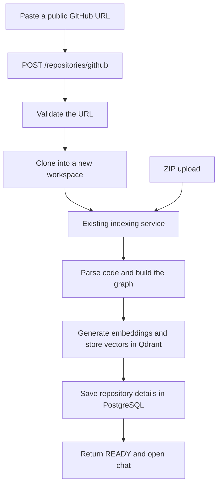

# GitHub import

GitHub import accepts a public repository URL, downloads its default branch, and uses the existing ZIP indexing flow. Local-path import has been removed from the frontend and backend.

## Architecture



## How the code works

### 1. Receive the URL

[`frontend-next/src/components/RepositoryManager.tsx`](../frontend-next/src/components/RepositoryManager.tsx) keeps the existing GitHub tab and URL field. The local-path tab, its icon, and its conditional form text are removed. A URL passed from the landing page now always selects GitHub import.

The browser checks that the input looks like an HTTPS GitHub repository URL. It accepts an optional `.git` ending and trailing slash. This gives quick feedback; the backend performs its own validation before running Git.

[`frontend-next/src/lib/api.ts`](../frontend-next/src/lib/api.ts) puts the URL into a `FormData` field named `github_url` and posts it to `/repositories/github`. This was already the frontend's intended GitHub request format. The old request that sent a server folder path to `/index` is removed.

Import requests now have a ten-minute browser timeout, matching the existing proxy setting. `AbortSignal.any` combines that timeout with the Cancel button's signal: either one can stop the browser request. Cancellation does not guarantee that indexing has stopped on the backend.

The existing submit handler checks the returned status. A completed import returns a repository ID, `READY`, and node/edge counts. The frontend saves that repository in browser history, refreshes the graph query, and opens chat. Older live repository entries still need re-indexing because the existing backend holds one active graph.

### 2. Handle the request

[`backend/app/api/routes/repositories.py`](../backend/app/api/routes/repositories.py) now registers `POST /repositories/github` on the router that `main.py` already mounts. `Form(...)` reads the URL. `Depends(get_db)` supplies the existing database session.

The route calls `repository_service.import_github`. An existing `HTTPException` keeps its status and message. A `ValueError`, such as an invalid URL or a repository without supported symbols, becomes HTTP 400. Other failures use HTTP 500, matching the existing ZIP route's error handling.

### 3. Validate and clone

[`backend/app/repositories/github.py`](../backend/app/repositories/github.py) contains the Git-specific work:

- `validate_url` trims surrounding spaces and checks the entire URL with `re.fullmatch`. It permits only HTTPS, the exact `github.com` host, an owner, and a repository name. It rejects credentials, query strings, extra paths, other hosts, and the special names `.` and `..`.
- The first regex group is the owner; the second is the repository name. Optional `.git` and trailing slash are removed so the service receives one consistent URL format.
- `clone` validates again so this helper remains safe when called directly. It adds `.git` to the normalized URL and runs Git with a list of arguments. The input is never executed as a shell command.
- `--depth 1` downloads the latest history entry. `--single-branch` limits the checkout to the default branch. `--` separates Git options from the URL and destination.
- `credential.helper=` disables saved credential helpers for this command. `GIT_TERMINAL_PROMPT=0` and an empty `GIT_ASKPASS` prevent a public import from opening a login prompt.
- `http.followRedirects=false` keeps Git from following the URL to another destination.
- `check=True` raises an error when Git fails. `capture_output=True` and `text=True` make Git's error message available as text. `timeout=120` limits cloning to two minutes.

The exception handlers translate failures into useful responses: missing or private repository → 404; connection/clone failure → 502; Git not installed → 503; clone timeout → 504. Private repository authentication is not part of this feature.

### 4. Reuse the existing indexing flow

[`backend/app/services/repository_service.py`](../backend/app/services/repository_service.py) adds `import_github` and extracts the existing ZIP indexing/database code into `_index_repository`.

`import_github` validates the URL before creating a workspace. It uses the existing storage helper to create a unique workspace, then chooses a repository directory inside it. `run_in_threadpool` lets the blocking Git command run while the API waits for it. It does not create a background indexing job.

After cloning, `_index_repository` calls the same `index_service.index_repository` used by ZIP upload. That existing service builds the graph, vectors, and keyword search index, and activates the repository in application state. The shared method creates the database record, saves the existing statistics, and returns the existing response format. GitHub records also save `source_type="github"` and the normalized URL. The size calculation excludes Git's `.git` directory so downloaded history is not counted as source code.

If GitHub import fails, the service rolls back the pending database transaction and removes that import's workspace before passing the error back to the route. It never reports a failed import as `READY`.

### 5. Reject repositories without usable code

[`backend/app/core/indexer/pipeline.py`](../backend/app/core/indexer/pipeline.py) now rejects an empty list of parsed symbols with a clear message. Supported input remains Python, JavaScript, and TypeScript as provided by the existing parser.

The vector collection is reset after parsing and embedding succeed. Previously it was reset before reading the repository. This small ordering change preserves the current vectors when a new repository has no supported symbols or fails before vector upload. It does not add transactional rollback for a failure during vector upload.

### 6. Remove the old feature and duplicate stub

`main.py` no longer mounts the local-path router. Its unused route and request schema are deleted. The unused folder-copy methods are also removed. The old, unmounted GitHub route and its `NotImplementedError` method are removed so there is one GitHub implementation.

The landing page, Settings, workspace guide, and earlier frontend no longer advertise local-path import. The API documentation describes GitHub as available in current mode. `tests/mock-api.mjs` now models the GitHub multipart request instead of local-path indexing; it remains a browser fixture rather than evidence of real indexing.

## Verification

Run the focused backend tests from `backend/`:

```bash
../.venv/bin/python -m pytest tests/unit/test_github.py tests/integration/test_github_import.py -q
```

`test_github.py` checks URL normalization and rejection, Git command options, and clone error messages. `test_github_import.py` checks the actual HTTP router/service flow with cloning, indexing, and database calls replaced by test doubles. It verifies successful import, required input, failure cleanup, continued ZIP support, and preservation of the vector collection for an empty repository.

The live checks use the real Git command, embedding model, PostgreSQL, and Qdrant. Importing `https://github.com/pallets/itsdangerous` through the frontend proxy returned `READY`, 256 graph nodes, and 342 edges. PostgreSQL contained the corresponding GitHub repository record, and Qdrant contained 135 vectors. Invalid, missing, and unsupported-code imports returned the expected errors while preserving that graph and those vectors. A browser import using `.git/` also completed and opened chat with the repository active. See [testing](TESTING.md) for the project's broader verification limits.

## Running locally

The backend needs Git, PostgreSQL with the existing migrations applied, Qdrant, and the embedding model. Start the data services using the existing Compose file. Use live mode in the frontend and the current API contract, then choose GitHub on the Repositories screen.

The current settings code reads the repository-root `.env`. Its database credentials must match the local PostgreSQL instance. GitHub import does not require a GitHub token or execute code from the imported repository.
