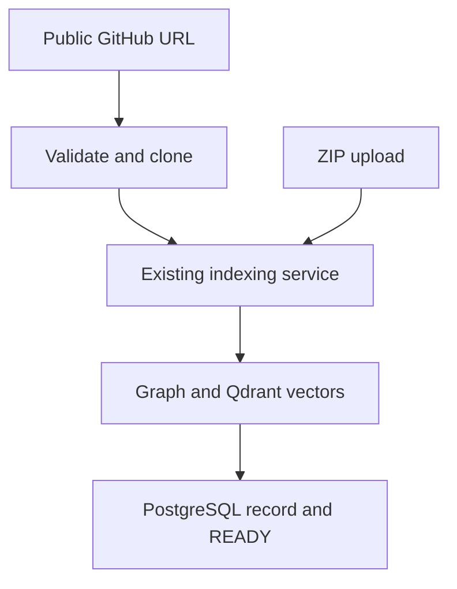

# GitHub import

Paste a public GitHub repository URL to import its default branch. GitHub and ZIP imports share the same indexing code. Local-path import has been removed.

## Use it

Start the app using [Getting started](GETTING-STARTED.md). The backend needs Git, PostgreSQL, Qdrant, and its embedding model.

Choose **Live mode → Repositories → GitHub**. Enter `https://github.com/owner/repo`. An ending of `.git`, `/`, or `.git/` is also accepted. Private repositories are not supported.

## Follow the code

| File | What it does |
| --- | --- |
| [RepositoryManager.tsx](../frontend-next/src/components/RepositoryManager.tsx) | Reads the URL, shows errors, saves the ready repository, and opens chat |
| [api.ts](../frontend-next/src/lib/api.ts) | Sends the URL in the `github_url` form field |
| [repositories.py](../backend/app/api/routes/repositories.py) | Handles `POST /repositories/github` and gets a database session |
| [github.py](../backend/app/repositories/github.py) | Checks the URL and runs Git |
| [repository_service.py](../backend/app/services/repository_service.py) | Creates a workspace, runs the import, and saves the result |
| [pipeline.py](../backend/app/core/indexer/pipeline.py) | Parses code, builds the graph, and stores vectors |

### Check the URL

`validate_url` removes outside spaces and checks the whole URL. Only HTTPS, the exact `github.com` host, an owner, and a repository name are allowed.

The first regex group is the owner; the second is the repository name. Optional `.git` and `/` endings are removed. Credentials, extra paths, query strings, other hosts, `.` and `..` are rejected.

The browser checks the format for quick feedback. The service validates before creating a workspace. The Git helper validates again so direct calls are also checked.

### Download the code

`clone` passes Git a list of arguments. The URL is never run as a shell command.

| Option | Why it is used |
| --- | --- |
| `--depth 1` | Download only the latest history entry |
| `--single-branch` | Download the default branch |
| `--` | End Git options before the URL and folder |
| `credential.helper=` | Avoid using saved login helpers |
| `GIT_TERMINAL_PROMPT=0`, empty `GIT_ASKPASS` | Prevent login prompts |
| `http.followRedirects=false` | Keep Git from following redirects |
| `check=True` | Raise an error if Git fails |
| `capture_output=True`, `text=True` | Read Git errors as text |
| `timeout=120` | Stop waiting for a clone after two minutes |

`run_in_threadpool` runs the blocking clone while the API waits. It does not create a background indexing job.

### Index and save

`import_github` creates a unique workspace and a repository folder inside it. After cloning, it calls `_index_repository`, which is also used by ZIP upload.

That shared method calls the existing index service, creates the database record, saves statistics, and returns the repository ID, `READY`, nodes, and edges. GitHub records also store the URL and `source_type="github"`. Source size excludes `.git` history.

The frontend allows ten minutes for import, matching the proxy. `AbortSignal.any` combines the timeout and Cancel button. Cancelling stops the browser request; the backend may still finish.

### Handle failures

| Code | Problem |
| --- | --- |
| 400 | Invalid URL or no supported functions/classes |
| 404 | Missing or private repository |
| 500 | Indexing, database, or another server error |
| 502 | Clone connection failed |
| 503 | Git is missing |
| 504 | Clone timed out |

The route keeps known HTTP errors, converts `ValueError` to 400, and uses 500 for other errors. The service rolls back the pending database work and removes the failed import's workspace.

The pipeline rejects empty results before resetting Qdrant. Parsing or embedding failure therefore preserves the previous vectors. Failure during vector upload still has no automatic restore.

### Remove the old path

The local-path route, request schema, client branch, folder-copy methods, and UI controls were removed. The unused GitHub route and unfinished manager method were also removed, leaving one active GitHub implementation. The fake API now models GitHub import.

## Checks

The helper tests cover URL checks, Git options, and clone errors. The API tests cover success, missing input, cleanup, and ZIP support. A real browser import also passed. Commands and results are in [Testing](TESTING.md#github-import).

Only one repository is active at a time. Import again after restarting the API.
