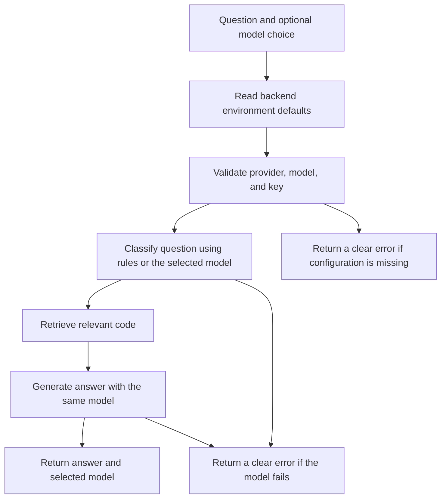

# Choose an AI provider and model

Set the defaults in the root `.env` file. On Render, use the service's Environment page. Restart the backend after changing settings.

```dotenv
LLM_PROVIDER=gemini
GEMINI_API_KEY=your-google-key
GEMINI_MODEL=gemini-3.8-flash
GEMINI_THINKING_LEVEL=low
LLM_TIMEOUT_SECONDS=60
LLM_MAX_OUTPUT_TOKENS=4096
```

`low` reduces thinking work for Gemini 3 models. Use `medium` or `high` for harder questions. The output limit includes thinking tokens; increase it if a request reaches the limit. Other Gemini model families use their own thinking defaults.

## How selection works



The app never switches to another provider or model after a failure. Failed classification is not replaced with a guessed label. OpenRouter provider fallback is disabled; automatic model routers are rejected. Provider-side changes behind model aliases are outside the app's control.

## Supported providers

Set `LLM_PROVIDER` to a value below. Set that provider's key and exact model ID. Google also accepts `google` as an alias for `gemini`.

| Provider | API key setting | Model setting |
| --- | --- | --- |
| `gemini` | `GEMINI_API_KEY` | `GEMINI_MODEL` |
| `openai` | `OPENAI_API_KEY` | `OPENAI_MODEL` |
| `anthropic` | `ANTHROPIC_API_KEY` | `ANTHROPIC_MODEL` |
| `deepseek` | `DEEPSEEK_API_KEY` | `DEEPSEEK_MODEL` |
| `groq` | `GROQ_API_KEY` | `GROQ_MODEL` |
| `mistral` | `MISTRAL_API_KEY` | `MISTRAL_MODEL` |
| `xai` | `XAI_API_KEY` | `XAI_MODEL` |
| `openrouter` | `OPENROUTER_API_KEY` | `OPENROUTER_MODEL` |

Only the selected provider needs a key. Use a model that supports text chat and is available to your account. Different providers have different charges and limits.

In frontend Settings, choose **Backend default** to follow the environment. To override it, choose a provider and enter a model ID. A blank model uses that provider's environment setting. Old saved `gemini-3.5-flash` defaults are migrated to Backend default; other saved choices are kept.

## Code map

| Code | Purpose |
| --- | --- |
| `config.py` | Reads model names, keys, timeout, and output limit from the environment |
| `llm/factory.py` | Resolves and validates selection, then reuses the matching client |
| `llm/providers/` | Calls Google, Anthropic, or an OpenAI-compatible text chat API |
| `retrieval/intent.py` | Uses rules first, then the selected model if needed |
| `query_service.py` | Keeps one provider and model throughout a question |
| `/query` | Returns configuration errors as 400 and model failures as 502 |

Tests use mock HTTP responses with the real Google and OpenAI clients, plus the Anthropic HTTP adapter. They check selection, request format, and failure handling. They do not verify credentials or access to every hosted model.

These settings change answer generation and question classification. The local embedding model and reranker still use backend RAM.
