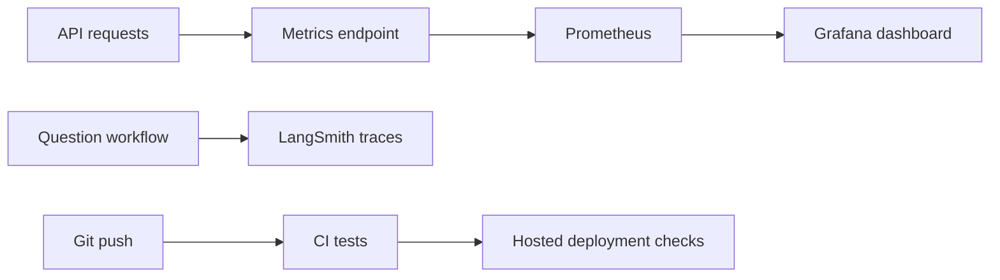

# Monitoring and CI

These tools check different parts of CodeSage.



## Prometheus and Grafana

Start the API on port 8000, then run from the repository root:

```bash
docker compose -f infra/docker-compose.yml up -d prometheus grafana
```

- [Prometheus targets](http://localhost:9090/targets): `codesage` should be **UP**.
- [Grafana dashboard](http://localhost:3001/d/codesage/codesage): local login is `admin` / `admin` on a new installation.
- The data source and dashboard load automatically. Monitoring data uses Docker volumes.
- Make an API request, then allow up to 15 seconds for Prometheus to collect it.

The dashboard shows API availability, requests, errors, latency, questions, retrieval time, and model time. Query panels need real questions before they show data. Scraping `/metrics` does not count as an app request.

## LangSmith

Add these settings to the root `.env` file, then restart the API:

```dotenv
LANGSMITH_TRACING=true
LANGSMITH_API_KEY=your-key
LANGSMITH_PROJECT=codesage
LANGSMITH_ENDPOINT=https://api.smith.langchain.com
```

Use your account's regional endpoint if needed. Set `LANGSMITH_WORKSPACE_ID` for keys shared across workspaces.

From `backend/`, run:

```bash
python -m app.observability.check_langsmith
```

This sends a synthetic question and checks that LangSmith saved its parent and child traces. It makes no model call. Real tracing sends questions, retrieved code, and answers to LangSmith. Set `LANGSMITH_TRACING=false` to disable it.

## CI and deployment checks

- **CodeSage CI** runs frontend checks and backend tests without private keys or live model calls.
- **Monitoring configuration** validates Compose, Prometheus, and Grafana files.
- **Deployment checks** runs after successful CI on a push to `main`. It waits for Vercel's commit status and checks the hosted frontend and Render API separately.

Vercel and Render deploy through their existing Git integrations. GitHub checks report their results; they do not configure those integrations or prevent them from deploying before CI finishes. Render's free backend currently fails during model loading, so its deployment check should fail until that memory problem is fixed.

The unfinished answer-quality evaluation is not a CI gate. See [Testing](TESTING.md) for the exact test scope.
