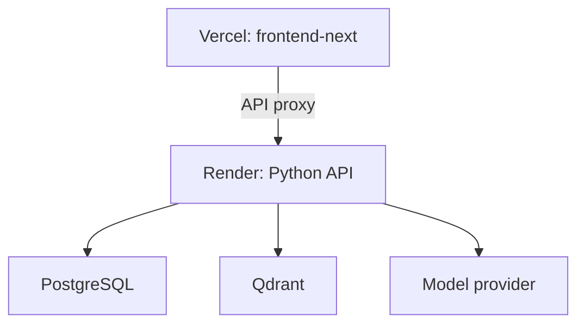

# Operations

The [frontend and demo](https://code-sage-gray.vercel.app/) are live on Vercel. The [Render backend](https://codesage-x5l2.onrender.com/) successfully deployed the cloud-model configuration on 23 October 2026. The previous startup memory failure is resolved for the tested deployment; full indexing and chat still depend on working database services.

## Deployment verification — 23 October 2026

- Commit `5af6f43` deployed successfully on Render's existing free instance. Deployment `dep-dbdos2om7kps73b6gmp0` applied the corrected environment settings and completed successfully.
- Render's stale `EMBED_MODEL=microsoft/unixcoder-base` override was replaced with `gemini-embedding-2`. `EMBED_PROVIDER=gemini`, `RERANK_PROVIDER=gemini`, and `RERANK_MODEL=gemini-3.8-flash` are explicitly configured. Existing credentials were preserved.
- The public root endpoint returned HTTP 200. A synthetic two-function ZIP parsed successfully, and Render recorded HTTP 200 from Gemini's embedding endpoint.
- The import then failed with a connection reset from the configured Qdrant Cloud endpoint. The same endpoint reset unauthenticated connection checks on ports 443 and 6333. This does not establish whether the cluster is paused, deleted, or otherwise unavailable; inspect Qdrant Cloud before changing its configuration.
- Backend process resident memory after this small import attempt was approximately 358 MiB. This is one process measurement, not a guarantee of peak memory for larger repositories.
- No successful end-to-end indexing or chat result has yet been established for this deployment. PostgreSQL operations occur after vector indexing and remain unverified by this smoke test.



## Build the frontend

Run from `frontend-next/`:

```bash
npm run build
npm start
```

Set `CODESAGE_BACKEND_URL` and `NEXT_PUBLIC_API_MODE=current` before building. Rebuild after changing them.

## Hosted settings

- Vercel uses `frontend-next` as the root directory and the default Next.js build.
- `CODESAGE_BACKEND_URL` points to `https://codesage-x5l2.onrender.com`.
- `NEXT_PUBLIC_API_URL=/api/backend` sends browser requests through the frontend proxy.
- Render stays on the free plan. Cloud retrieval models are the default. Opting into local models requires additional packages and enough backend memory; a successful frontend build does not verify live indexing.

## Docker builds

For a frontend Docker image, run from the same folder:

```bash
docker build --build-arg CODESAGE_BACKEND_URL=http://backend:8000 -t codesage-frontend-next .
```

Build the backend image from the repository root:

```bash
docker build -t codesage-backend backend
```

Pass backend settings as environment variables. Containers need working network names; `localhost` points to the container itself. The current Qdrant client defaults to localhost. Container deployment still needs testing.

## Stop or restart local services

From the repository root:

```bash
docker compose -f infra/docker-compose.yml stop
```

Start them again using [Getting started](GETTING-STARTED.md). After an API restart, import the repository again to rebuild its graph.

## Keep data and keys safe

- Keep provider keys in backend settings, outside Git and `NEXT_PUBLIC_*` variables.
- Relevant source is sent to the answer provider. Question classification uses the same selected provider.
- Source folders and Qdrant payloads keep copies of imported code.
- Back up PostgreSQL, Qdrant, source folders, and the matching app version together. Test that they can be restored.

The supplied Compose file uses development passwords. Monitoring has persistent volumes; the database and source services still need their own backup setup. A database backup alone cannot rebuild the active graph.

## Monitor problems

| Tool | What to check |
| --- | --- |
| API logs | Import, database, model, and search errors |
| `/metrics` | Recorded request and search measurements |
| Prometheus | The configured target is `host.docker.internal:8000` |
| Grafana | Open the automatically loaded dashboard on port 3001 |
| LangSmith | Enable tracing and verify that workflow traces arrive |

See [Monitoring and CI](MONITORING.md) for commands and settings. The root API route only returns a message; it does not check database, model, or vector-store readiness.

## Before public deployment

Add login, user permissions, separate repository state, upload limits, persistent storage, HTTPS, service health checks, and a tested restore process.

The production Compose file is empty. Hosted Git deployments use Vercel and Render settings; GitHub checks verify the resulting services. See [Testing](TESTING.md) for the recorded checks.
