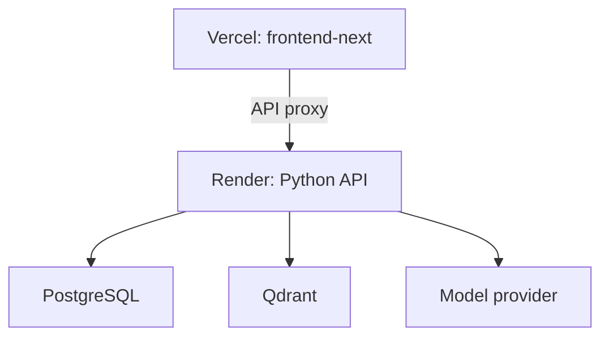

# Operations

The [frontend and demo](https://code-sage-gray.vercel.app/) are live on Vercel. Live import and chat are unavailable: the Render backend runs out of memory while loading its embedding model on the free 512 MB plan.



## Build the frontend

Run from `frontend-next/`:

```bash
npm run build
npm start
```

Set `CODESAGE_BACKEND_URL` and `NEXT_PUBLIC_API_MODE=current` before building. Rebuild after changing them.

## Hosted settings

- Vercel uses `frontend-next` as the root directory and the default Next.js build.
- `CODESAGE_BACKEND_URL` points to `https://codesage-x5l2.onrender.com`.
- `NEXT_PUBLIC_API_URL=/api/backend` sends browser requests through the frontend proxy.
- Render stays on the free plan. The current local models need more memory; a successful frontend build does not mean live indexing works.

## Docker builds

For a frontend Docker image, run from the same folder:

```bash
docker build --build-arg CODESAGE_BACKEND_URL=http://backend:8000 -t codesage-frontend-next .
```

Build the backend image from the repository root:

```bash
docker build -t codesage-backend backend
```

Pass backend settings as environment variables. Containers need working network names; `localhost` points to the container itself. The current Qdrant client defaults to localhost. Container deployment still needs testing.

## Stop or restart local services

From the repository root:

```bash
docker compose -f infra/docker-compose.yml stop
```

Start them again using [Getting started](GETTING-STARTED.md). After an API restart, import the repository again to rebuild its graph.

## Keep data and keys safe

- Keep provider keys in backend settings, outside Git and `NEXT_PUBLIC_*` variables.
- Relevant source is sent to the answer provider. Question classification uses the same selected provider.
- Source folders and Qdrant payloads keep copies of imported code.
- Back up PostgreSQL, Qdrant, source folders, and the matching app version together. Test that they can be restored.

The supplied Compose file uses development passwords. Monitoring has persistent volumes; the database and source services still need their own backup setup. A database backup alone cannot rebuild the active graph.

## Monitor problems

| Tool | What to check |
| --- | --- |
| API logs | Import, database, model, and search errors |
| `/metrics` | Recorded request and search measurements |
| Prometheus | The configured target is `host.docker.internal:8000` |
| Grafana | Open the automatically loaded dashboard on port 3001 |
| LangSmith | Enable tracing and verify that workflow traces arrive |

See [Monitoring and CI](MONITORING.md) for commands and settings. The root API route only returns a message; it does not check database, model, or vector-store readiness.

## Before public deployment

Add login, user permissions, separate repository state, upload limits, persistent storage, HTTPS, service health checks, and a tested restore process.

The production Compose file is empty. Hosted Git deployments use Vercel and Render settings; GitHub checks verify the resulting services. See [Testing](TESTING.md) for the recorded checks.
