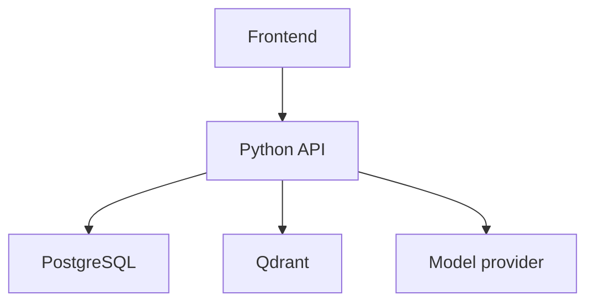

# Operations

Use CodeSage as a local development app. Public deployment is not ready yet.



## Build the frontend

Run from `frontend-next/`:

```bash
npm run build
npm start
```

Set `CODESAGE_BACKEND_URL` and `NEXT_PUBLIC_API_MODE=current` before building. Rebuild after changing them.

For a frontend Docker image, run from the same folder:

```bash
docker build --build-arg CODESAGE_BACKEND_URL=http://backend:8000 -t codesage-frontend-next .
```

Build the backend image from the repository root:

```bash
docker build -t codesage-backend backend
```

Pass backend settings as environment variables. Containers need working network names; `localhost` points to the container itself. The current Qdrant client defaults to localhost. Container deployment still needs testing.

## Stop or restart local services

From the repository root:

```bash
docker compose -f infra/docker-compose.yml stop
```

Start them again using [Getting started](GETTING-STARTED.md). After an API restart, import the repository again to rebuild its graph.

## Keep data and keys safe

- Keep provider keys in backend settings, outside Git and `NEXT_PUBLIC_*` variables.
- Relevant source is sent to the answer provider. The intent fallback may send questions to Gemini.
- Source folders and Qdrant payloads keep copies of imported code.
- Back up PostgreSQL, Qdrant, source folders, and the matching app version together. Test that they can be restored.

The supplied Compose file uses development passwords and has no persistent data volumes. Recreating containers can lose data. A database backup alone cannot rebuild the active graph.

## Monitor problems

| Tool | What to check |
| --- | --- |
| API logs | Import, database, model, and search errors |
| `/metrics` | Recorded request and search measurements |
| Prometheus | The configured target is `host.docker.internal:8000` |
| Grafana | Import the [dashboard JSON](../infra/grafana/dashboards/codesage.json) manually |

Grafana uses port 3000 in Compose, which conflicts with the frontend. The root API route only returns a message; it is not a health check.

## Before public deployment

Add login, user permissions, separate repository state, upload limits, persistent storage, HTTPS, service health checks, and a tested restore process.

The production Compose file is empty, and the deploy workflow is a placeholder. The Next.js build has also reported a security-version warning; update the dependency before public deployment. See [Testing](TESTING.md) for the recorded checks.
