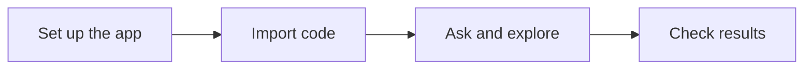

# Documentation

Start with setup. Use the other guides when you need a specific detail.

| Guide | Use it to |
| --- | --- |
| [Getting started](GETTING-STARTED.md) | Run the demo or local backend |
| [AI providers](MODEL-PROVIDERS.md) | Choose a provider and model without automatic fallback |
| [Architecture](ARCHITECTURE.md) | Understand the main parts and stored data |
| [GitHub import](GITHUB-IMPORT.md) | Follow the import code step by step |
| [API](API.md) | Find working routes and request examples |
| [Testing](TESTING.md) | Run checks and see what was tested |
| [Operations](OPERATIONS.md) | Build, monitor, and restart the app |
| [Monitoring and CI](MONITORING.md) | Run Prometheus, Grafana, LangSmith, and workflow checks |
| [Frontend](../frontend-next/README.md) | Find screens and frontend settings |
| [API contract](../frontend-next/API-CONTRACT.md) | Connect the UI to current or planned routes |
| [Design](../frontend-next/DESIGN.md) | Follow the UI rules |
| [Browser checks](../frontend-next/QA.md) | See the recorded UI checks |

Working features and planned features are labeled separately. Demo results are examples.
