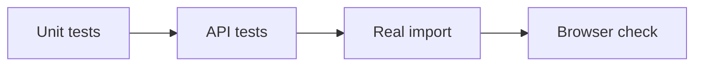

# Testing

Run the checks for the code you change. A fake API can check frontend requests, but it cannot prove that real indexing works.



## Frontend

Run from `frontend-next/` after installing dependencies:

```bash
npm run typecheck
npm run lint
npm test
npm run build
```

The nine protocol tests cover streamed data, citations, graph formats, and metrics. [Browser checks](../frontend-next/QA.md) are recorded separately.

For a fake API, run `npm run test:api`. It uses port 8000; stop the real API first and stop the fake API when finished.

## Backend

With the Python environment active, run from the repository root:

```bash
cd backend
python -m pytest -m 'not model' -q
python -m pytest -q
```

The first command runs CI's automated tests without model downloads, private keys, or live services. The second also runs the real embedding and in-memory Qdrant integration; it needs the embedding model files.

The import API tests replace external calls with test doubles. Old scripts that make live Gemini, Celery, embedding, or Qdrant calls during import are excluded from pytest collection; run those scripts directly when needed. Sample repository files are fixtures, not application tests.

On **23 October 2026**, the backend suite excluding the real embedding test passed **93 tests**. The separate embedding integration passed earlier during monitoring checks. Monitoring tests cover requests, errors, route labels, and LangGraph parent and child trace export. A real API request was collected by Prometheus and queried through Grafana. Hosted LangSmith still requires a configured API key.

## Model selection

- Provider tests use mock HTTP responses with the real Google and OpenAI SDKs, plus the Anthropic HTTP adapter.
- Tests check environment defaults, explicit choices, each provider's credentials and endpoint, rate limits, empty replies, and fallback prevention.
- API tests check 400 configuration errors, 502 model errors, and the selected model in successful responses.
- Browser checks confirmed that model preferences survive a reload and Backend default uses environment settings.
- Google's model metadata API recognized `gemini-3.8-flash` with the configured key. No live generation calls were made for this change.

See [AI providers](MODEL-PROVIDERS.md) for configuration and supported providers.

## GitHub import

Recorded on **22 October 2026**:

| Check | Result |
| --- | --- |
| Focused backend tests | 34 passed |
| Frontend type check, lint, tests, build | Passed |
| Real `pallets/itsdangerous` import | `READY`; 256 nodes, 342 edges, 135 vectors |
| Database | GitHub repository record saved |
| Wrong host / missing repo / no supported code | 400 / 404 / 400 |
| Existing graph and vectors after failed import | Preserved |
| Browser with a `.git/` URL | Import completed; chat opened |

The real check used Git, the embedding model, PostgreSQL, and Qdrant. Local services were started and existing database migrations applied. Environment settings were preserved. The build reported a Next.js security-version warning.

Deployment checks on **23 October 2026**: Next.js and its ESLint config were updated to 16.4.2. Type checking, lint, all nine frontend tests, and the production build passed. The production dependency audit found no vulnerabilities. The deployed demo opened successfully. Render's free backend failed during model loading because it exceeded 512 MB; hosted live import remains unverified.

## Answer-quality evaluation

The [golden question set](../backend/app/evaluation/golden_set.json) lists questions and expected code.

| Metric | Meaning |
| --- | --- |
| Intent accuracy | Was the question type correct? |
| Topology recall | Was the expected connected code found? |
| Citation precision | Did citations point to the right code? |
| Faithfulness | Did the code support the answer? |
| Context recall / precision | Was the needed code found, with little unrelated code? |
| Test mention rate | Did the answer mention relevant tests? |

Evaluation is unfinished: its API route is not registered, `baseline.json` is missing, and Ragas is absent from the requirements. CI does not claim to run this evaluation. See [Monitoring and CI](MONITORING.md) for the working workflow checks.

Live answer quality, the hosted backend, and arbitrary repository sizes have not been verified. Demo scores are examples.
