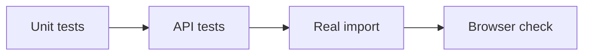

# Testing

Run the checks for the code you change. A fake API can check frontend requests, but it cannot prove that real indexing works.



## Frontend

Run from `frontend-next/` after installing dependencies:

```bash
npm run typecheck
npm run lint
npm test
npm run build
```

The nine protocol tests cover streamed data, citations, graph formats, and metrics. [Browser checks](../frontend-next/QA.md) are recorded separately.

For a fake API, run `npm run test:api`. It uses port 8000; stop the real API first and stop the fake API when finished.

## Backend

With the Python environment active, run from the repository root:

```bash
cd backend
python -m pytest tests/unit/test_github.py tests/integration/test_github_import.py -q
python -m pytest tests/unit/test/test_queries.py
```

The import tests check URLs, clone errors, cleanup, saved results, continued ZIP support, and an empty repository. Their API tests replace external calls with test doubles. Importing the test modules still needs the backend dependencies, settings, and model files.

The graph-query tests run without external services. The full suite is `python -m pytest tests`. Some older tests need fixes or external services, so it is not a verified release check.

## GitHub import

Recorded on **22 October 2026**:

| Check | Result |
| --- | --- |
| Focused backend tests | 34 passed |
| Frontend type check, lint, tests, build | Passed |
| Real `pallets/itsdangerous` import | `READY`; 256 nodes, 342 edges, 135 vectors |
| Database | GitHub repository record saved |
| Wrong host / missing repo / no supported code | 400 / 404 / 400 |
| Existing graph and vectors after failed import | Preserved |
| Browser with a `.git/` URL | Import completed; chat opened |

The real check used Git, the embedding model, PostgreSQL, and Qdrant. Local services were started and existing database migrations applied. Environment settings were preserved. The build reported a Next.js security-version warning.

Deployment checks on **23 October 2026**: Next.js and its ESLint config were updated to 16.4.2. Type checking, lint, all nine frontend tests, and the production build passed. The production dependency audit found no vulnerabilities. The deployed demo opened successfully. Render's free backend failed during model loading because it exceeded 512 MB; hosted live import remains unverified.

## Answer-quality evaluation

The [golden question set](../backend/app/evaluation/golden_set.json) lists questions and expected code.

| Metric | Meaning |
| --- | --- |
| Intent accuracy | Was the question type correct? |
| Topology recall | Was the expected connected code found? |
| Citation precision | Did citations point to the right code? |
| Faithfulness | Did the code support the answer? |
| Context recall / precision | Was the needed code found, with little unrelated code? |
| Test mention rate | Did the answer mention relevant tests? |

Evaluation is unfinished: its API route is not registered, `baseline.json` is missing, and Ragas is absent from the requirements. The CI quality checks also reference missing entry points. The deploy workflow is a placeholder.

The full backend suite, live answer quality, public deployment, and arbitrary repository sizes have not been verified. Demo scores are examples.
