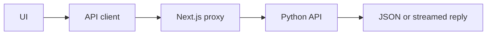

# Frontend API contract

Use `NEXT_PUBLIC_API_MODE=current` with this backend. The client code is in [api.ts](src/lib/api.ts); shared shapes are in [types.ts](src/lib/types.ts).



## Current API

The frontend forwards `/api/backend/*` to the Python API. It reads `/openapi.json` to check which routes exist. Missing features stay unavailable.

| Action | Request | Response |
| --- | --- | --- |
| ZIP import | `POST /repositories/upload`, form field `file` | `{ repository_id, status: "READY", nodes, edges }` |
| GitHub import | `POST /repositories/github`, form field `github_url` | Same import result |
| Question | `POST /query`, JSON `{ query, repository_id, model_provider, model_name }` | `{ answer, intent, confidence, citations }` |
| Graph | `GET /graph` | `{ nodes, edges }` |
| Metrics | `GET /metrics` | Prometheus text |

See [API](../docs/API.md) for graph fields and error codes. Import waits up to ten minutes in the browser; cloning has a two-minute limit. Cancel may leave backend work running.

The backend holds one active repository. An ID does not switch graphs. Browser history is not a server repository list. Each live question is independent.

## Planned API

These formats are supported by the UI but are **not working backend routes yet**. Implement and test them before switching to `planned` mode. Set the mode before building, then rebuild.

### Import and progress

| Route | Input |
| --- | --- |
| `POST /repositories/zip` | Form field `file` |
| `POST /repositories/file` | Form field `file` |
| `POST /repositories/text` | Form fields `filename`, `content` |

GitHub keeps its current route. Completed imports return `{ repository_id, status: "ready", nodes, edges }`.

A background import returns `{ job_id, repository_id, status: "queued" }`. It must provide `GET /index/progress/{job_id}` as a stream of JSON events:

```json
{ "status": "indexing", "progress_percent": 50, "files_indexed": 10, "total_files": 20, "current_phase": "Embedding" }
```

Finish with `status: "done"`, a repository ID, nodes, and edges. Fail with `status: "error"` and `message`. If the ID was unknown at first, include it in the final event.

### Questions and streaming

In planned mode, `POST /query` receives `{ text, repo_id, model_provider, model_name }`.

It may return JSON or a `text/event-stream` reply. Each event starts with `data:` and ends with a blank line:

```text
data: {"intent":"EXPLAIN","confidence":0.92}

data: {"token":"The function checks the token."}

data: {"citations":[{"filepath":"auth.py","line":25}]}

data: [DONE]
```

A token may use `token` or `text`; a complete reply may use `answer`. Errors use `{ "type": "error", "message": "..." }`. Citation paths must be relative to the repository. Confidence in this example is a proposed value, not a measured result.

### Graph and source

| Route | Result |
| --- | --- |
| `GET /graph/{repo_id}` | Graph for that repository |
| `GET /file?path=...&repository_id=...` | Plain source text or `{ content }` |

Graph nodes may use current fields or `{ id, label, file, type, line, docstring, callers_count, test_coverage }`. Edges may add `call_frequency`; the UI defaults it to 1. The server must check file paths before reading source.

### Evaluation

- `POST /eval` receives `{ golden_set_path }`.
- It returns metrics directly, `{ metrics, test_cases, passed }`, or `{ job_id }`.
- For a job, the UI polls `GET /eval/status/{job_id}` every two seconds for up to ten minutes.
- Finish with `{ status: "done", result }`. A done response without `result` needs `GET /eval` to fetch the report. Errors use `{ status: "error", message }`.
- `GET /eval` returns `{ runs, latest, thresholds }`.

Each run has `id`, `timestamp`, `metrics`, and `test_cases`; `passed` is optional. Metrics include `faithfulness`, `topology_recall`, `intent_accuracy`, and `citation_precision`. A test case has `id`, `query`, `intent`, `retrieval_pass`, `answer_quality_pass`, and `latency_ms`; it may include `answer` and `retrieved_chunks`.

Send actual backend thresholds and pass/fail results. Missing test details should stay missing.

### Health

`GET /health` should return `{ status, qdrant, redis, postgres }` using real service checks. The UI shows missing checks as “Not reported”.

For recorded results and unfinished backend work, see [Testing](../docs/TESTING.md).
