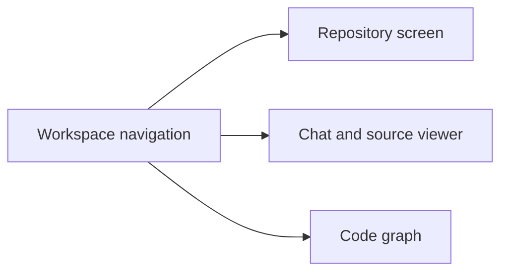

# UI design

Make code easy to read and the next action easy to find.

## Look and feel

| Part | Rule |
| --- | --- |
| Background | Light `#F8F7FB`; dark cover `#191522` |
| Text | Main color `#282331` |
| Accent | Purple `#7C65C1`, deep purple `#3D2F6B`, lavender `#EAE8F5` |
| Fonts | Inter for the UI; JetBrains Mono for code and paths |
| Cards | Rounded corners, clear labels, enough space between sections |
| Themes | Support light, dark, and system settings |
| Motion | Keep it brief; respect reduced-motion settings |

Fonts are served by the app. Use the serif accent only on the landing page.

## Content rules

- Use short labels and plain language.
- Show whether the workspace is live or a demo.
- Show real errors and backend status.
- Treat missing test coverage as unknown.
- Keep source code readable in both themes.
- On mobile, let users switch between chat and source.
- Keep graph views focused; the UI shows up to 350 symbols at a time.

Chats and repository history stay in the browser. Source previews disappear on refresh. Show these limits where users need them.

See [Frontend](README.md) for screens and [QA](QA.md) for recorded checks.
