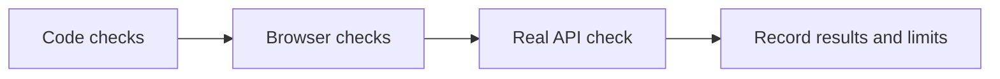

# Frontend verification

This is a record of completed checks. It is not a guarantee that every feature works.

## Latest checks: 22 October 2026

| Check | Result |
| --- | --- |
| TypeScript and lint | Passed |
| Protocol tests | 9 passed |
| Production build | Passed; reported an existing Next.js security-version warning |
| Real GitHub import | Passed through the frontend proxy and browser |
| Import result | `itsdangerous` became ready and chat opened with it selected |
| Local-path import | Removed from the UI; `/index` returned 404 |

The import used the real Python API, embedding model, PostgreSQL, and Qdrant. See [Testing](../docs/TESTING.md#github-import) for backend checks and counts.

## Earlier browser checks: 7 October 2026

| Area | Checked |
| --- | --- |
| Demo chat | New chats, sample answers, citations, source viewer |
| Graph | Search, filters, symbol details, and export |
| Evaluation | Sample scores, run comparison, and export |
| Workspace | Browser history, live/demo separation, navigation, themes |
| Layout | Desktop, tablet, and 375 px mobile screens |
| Fake API | Request fields, response formats, and missing-feature states |

These earlier checks used demo data and a fake API. Local-path checks from that review describe a feature that has since been removed.

Screenshots: [landing](docs/screenshots/landing.png), [workspace](docs/screenshots/workspace.png).

## Not yet verified

- Full live answer quality and retrieval accuracy.
- Planned streaming, progress, evaluation, health, and source-file routes.
- Public Docker deployment, load testing, and a full accessibility audit.

The graph displays up to 350 symbols at a time. Export JSON for the complete graph.
