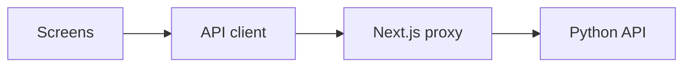

# CodeSage frontend

The Next.js app lets you import code, ask questions, and explore the code graph.



## Start it

Use Node.js 20.9 or later. Run from `frontend-next/`:

```bash
npm ci
cp .env.example .env.local
npm run dev
```

Open [localhost:3000](http://localhost:3000). Choose **Explore the demo** for sample data, or follow [backend setup](../docs/GETTING-STARTED.md) for live mode.

## Screens

| Route | Purpose |
| --- | --- |
| `/` | Introduction and demo |
| `/workspace` | Repository overview |
| `/repositories` | GitHub import and ZIP upload |
| `/chat` | Questions, answers, and source viewer |
| `/graph` | Code connections and graph export |
| `/eval` | Answer-quality results; live route is not ready |
| `/observability` | Metrics |
| `/settings` | Backend, model, theme, and workspace mode |
| `/docs` | User guide |

Unavailable backend features stay disabled. See the [API contract](API-CONTRACT.md).

## Settings and saved data

| Setting | Purpose |
| --- | --- |
| `CODESAGE_BACKEND_URL` | Proxy destination; default `http://127.0.0.1:8000` |
| `NEXT_PUBLIC_API_MODE` | Keep `current` for this backend |
| `NEXT_PUBLIC_API_URL` | Optional direct API address; the backend must allow the browser origin |

Set connection values before production builds. Rebuild after changing them. Keep provider keys in the backend.

- Chats and repository history stay in browser storage.
- Source previews stay in memory and disappear on refresh.
- Only the latest indexed repository is active on the backend.
- Each live question is separate; earlier chat messages are not sent to the API.

The UI allows uploads up to 100 MB. The proxy allows 102 MB and ten minutes. Cancel stops the browser request; backend indexing may continue.

## Check changes

```bash
npm run typecheck
npm run lint
npm test
npm run build
```

`npm run test:api` starts a fake API on port 8000. Stop the real API first. It checks frontend requests, not real indexing.

[Build and run](../docs/OPERATIONS.md) · [Design](DESIGN.md) · [Browser checks](QA.md)
